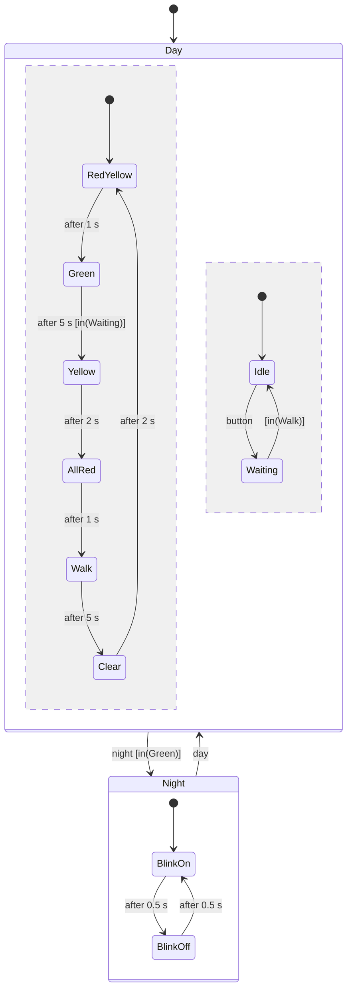

# Examples for chapter "Modelling"

Three state machines on a Raspberry Pi Pico in Wokwi, from a flat Moore
machine to a StateChart with hierarchy, concurrency and a simulated
environment.

| Folder | Content |
|---|---|
| `c/coffee_fsm` | coffee machine, flat Moore machine in C (`switch`, state table, output table) - browser |
| `coffee-fsm` | the same state machine as a hardware independent Rust library with unit tests |
| `pico-rust` | Rust program for the Pico that uses `coffee-fsm` - Wokwi for VS Code |
| `door` | garage door: StateChart with super-state, timed transitions, entry/exit actions and an orthogonal region; the door is a **custom chip** |
| `crossing` | pedestrian crossing: StateChart with an AND-super-state (two communicating regions) and a day/night OR-super-state |
| `test/coffee.yaml` | Wokwi scenario for the coffee machine (C and Rust) |

## Coffee machine (`c/`, `coffee-fsm`, `pico-rust`)

Circuit (`diagram.json`): buttons LEFT (GP10), RIGHT (GP11) to GND,
LEDs COFFEE (GP16), MILK (GP17), SUGAR (GP18), serial monitor on UART0.
The input READY is no longer a button: a timer creates it 3 s after a
"make ..." state was entered (a timed transition, `after(3 s)` in a
StateChart). The state machine itself is unchanged, only the source of the
event is.

```sh
cd coffee-fsm && cargo test           # 4 tests on the PC / Replit
cd pico-rust && cargo build --release
```

## Garage door (`door/`)

One button (REMOTE, GP10) opens, stops and closes the door. The door is a
custom chip (`chips/door.chip.c`): a model of the motor, the door leaf, two
end switches (TOP GP2, BOTTOM GP3) and a light barrier (BEAM GP4). The
controller drives the motor (UP GP16, DOWN GP17) and a warning lamp (GP18).
The chip shows the door on a small display.

```mermaid
stateDiagram-v2
    state Controller {
        [*] --> Closed
        Closed --> Opening: button
        state Moving {
            Opening
            Closing
        }
        Opening --> Open: top
        Opening --> Stopped: button
        Open --> Closing: button or after 10 s [beam free]
        Closing --> Opening: beam
        Closing --> Closed: bottom
        Closing --> Stopped: button
        Stopped --> Opening: button [moved down last]
        Stopped --> Closing: button [moved up last]
        Moving --> Fault: after 8 s
        Fault --> Opening: button
        --
        [*] --> Off
        Off --> On: after 250 ms [in(Moving)]
        On --> Off: after 250 ms or [not in(Moving)]
    }
```

What the example shows:

- super-state MOVING = {OPENING, CLOSING}: its transition "after 8 s without
  end switch → FAULT" leaves every sub-state, and is checked first
- timed transitions (`after(10 s)` auto close, motor timeout) with one
  entry time per state
- entry and exit actions in one function `enter()`: the motor is always
  switched off first, so UP and DOWN are never on together (the chip
  reports a short circuit if they are)
- guards: auto close only `[beam free]`
- an orthogonal region LAMP that runs in every tick and reads the state of
  the other region (`in(MOVING)`)
- the environment as a model: chip controls "Obstacle in the door" and
  "Door jammed" inject situations that are hard to test on a real door.
  Remove the transition `CLOSING ─beam─► OPENING` and the chip reports
  `CRASH: the door hits the obstacle!`

## Pedestrian crossing (`crossing/`)

Request button (GP10), night switch (GP11), car lights RED/YELLOW/GREEN
(GP16-18), pedestrian lights RED/GREEN (GP19-20), WAIT signal (GP21).



What the example shows:

- AND-super-state DAY with the regions TRAFFIC (6 states) and REQUEST
  (2 states). They communicate only through conditions on each other's
  state. The equivalent flat product machine has 6 × 2 = 12 states.
- OR-super-state OPERATING with DAY and NIGHT. NIGHT is entered only from
  the safe sub-state GREEN (a guard on the super-state transition), never
  in the middle of a pedestrian phase.
- one state variable per region; one tick function per region, all called
  in every tick

## Run in the browser

Open a new Pico project on <https://wokwi.com/projects/new/pi-pico>,
replace `sketch.ino` and `diagram.json`. For the door, also create the
custom chip (file menu "New file…" → "Custom chip (C)") named `door`, and
paste `chips/door.chip.c` and `chips/door.chip.json`. Click on the chip
during the simulation to put an obstacle into the door or to jam it.

## Run locally

```sh
cd door
arduino-cli compile -b rp2040:rp2040:rpipico --output-dir build .
wokwi-cli chip compile chips/door.chip.c -o chips/door.chip.wasm
wokwi-cli --scenario test/door.yaml --timeout 60000 .       # needs WOKWI_CLI_TOKEN

cd ../crossing
arduino-cli compile -b rp2040:rp2040:rpipico --output-dir build .
wokwi-cli --scenario test/crossing.yaml --timeout 40000 .
```

## Tested

- Coffee machine, Wokwi scenario `test/coffee.yaml` (C and Rust): LEFT,
  RIGHT, RIGHT → make coffee+milk+sugar (all three LEDs on, still on after
  2.3 s) → idle after 3 s (all LEDs off).
- Garage door, `door/test/door.yaml`: opens in 5 s, closes by itself after
  10 s, reverses when the obstacle appears, goes to FAULT 8 s after the
  door jams (motor off, lamp steady on), opens again after the button.
- Pedestrian crossing, `crossing/test/crossing.yaml`: request during green
  → WAIT on, cars keep the 5 s minimum green → yellow → all red → walk
  (WAIT off); night switch during walk takes effect only at the next green;
  yellow flashes at 1 Hz; back to day via red+yellow.
